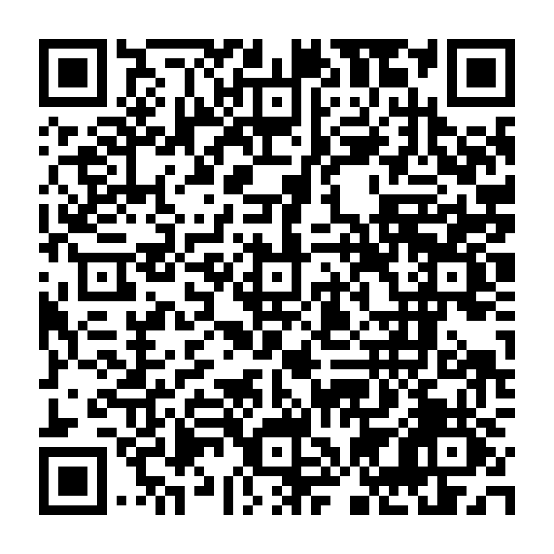

# Android용 FilmOne

[English](README.md) · 한국어

사진 한 장 또는 폴더를 선택하면 사진마다 장면을 인식해 필름을 고르고, 필요한 경우에만 노이즈를 줄인 뒤 새 JPEG 사본으로 저장합니다. 사진은 기기 안에서 처리합니다.

**[공개 다운로드 페이지](https://kangk1204.github.io/FilmOne-Downloads/?lang=ko)** · **[0.6.0 APK 바로 다운로드](https://github.com/kangk1204/FilmOne-Downloads/releases/download/v0.6.0/FilmOne-0.6.0-preview.apk)** · [릴리스 안내](https://github.com/kangk1204/FilmOne-Downloads/releases/tag/v0.6.0)

GitHub 로그인이 필요하지 않습니다. 이 저장소에는 다운로드 파일과 문서만 공개하며 앱 소스는 비공개로 유지합니다.



[QR 코드 저장](https://github.com/kangk1204/FilmOne-Downloads/releases/download/v0.6.0/FilmOne-0.6.0-download-qr.png) · [한국어 페이지](https://kangk1204.github.io/FilmOne-Downloads/?lang=ko) · [English page](https://kangk1204.github.io/FilmOne-Downloads/?lang=en)

## 0.6.0 GPU 노이즈 제거와 전체 작업 메모리 개선

지원하는 하드웨어에서는 원래 NAFNet-32 FP32 가중치를 WebGL2에서 직접 실행하여 GPU 경로의 CPU ONNX 세션을 없앴습니다. 원본 해상도·256픽셀 타일·중첩·필름 선택·모바일 단일 작업 정책은 유지합니다. 시험한 모델의 GPU 텍스처 할당 상한은 192.7MiB이며 재사용합니다. 업로드 큐 제한·소유한 모델/변환 버퍼의 즉시 해제·Blob 직접 캐시·분할 해시로 중간 복사도 줄였습니다. GPU 초기화 미지원·실패 시 CPU를 사용하며, 문맥 손실이나 비정상 출력 시 GPU를 해제한 후 같은 원본 타일을 CPU로 다시 처리합니다.

같은 Windows ARM64 / Adreno X1-45 PC와 Edge 157에서 고정된 0.5.8·0.6.0 편집기로 같은 12MP 합성 노이즈 사진을 ABBA 순서로 각 2회 처리했습니다. 전체 시간 중앙값은 **382.55 → 118.50초(69.0% 단축)**, 추론은 **359.89 → 88.15초**입니다. 전체 작업 최대 전용 커밋 메모리 표본은 **1875.22 → 1678.46MiB**, 같은 시점의 전용 커밋+GPU 커밋 합산 지표는 **1918.41 → 1738.68MiB(9.4% 감소)**였습니다. 합산 지표는 공유 매핑을 중복 계산할 수 있으며 실제 전체 RAM 사용량이 아닙니다. 고정 CPU 코어·4GiB 작업 상한·외부 CPU/GPU 부하·보정 측정 기준을 통과했습니다. 부하를 감시한 공용 PC 시험이며 휴대폰이나 완전히 격리된 GPU VM 시험은 아닙니다.

추가로 정한 추론 구간의 전용 커밋+GPU 커밋 유지 목표(증가 5% 이내)는 **통과**이며 **1233.44 → 1280.85MiB**였습니다. 이 목표의 판정은 그대로 남깁니다. 이번 미리보기는 모든 신규 실행의 전체 최대 메모리가 모든 기준 실행보다 낮고, 추론 구간 합산값도 기존 전체 최대값보다 낮다는 별도 공개 기준으로 배포합니다.

별도 Linux ARM64 CPU 대체 경로 ABBA 시험에서도 사전에 정한 속도 5% 이내 유지 기준을 통과했습니다. 전체 시간 **570.83 → 585.20초**, 전체 작업 최대 전용 상주 메모리 USS **1904.05 → 1637.97MiB**입니다. Windows GPU 시간과 Linux CPU 시간을 직접 비교하지 않습니다.

선정 자료 40개와 고정 확인 자료 20개가 원래 수치 오차·PSNR·SSIM·디테일 보존 기준을 통과했습니다. GPU 실수 출력은 CPU와 비트 단위로 같지는 않으며, 수치적으로 불안정한 선정 스트레스 입력 2개는 원래 CPU 경로로 복구합니다. 전체 12MP 저장 JPEG 비교도 통과했습니다. 최종 빌드는 단위·경계 테스트 201개와 변경 경로의 브라우저·Sites·실제 GPU/모의 네이티브 연결 검사를 통과했습니다. 100장 폴더·저장 실패·손상 모델·중단/재시작·원본 보존을 검증했습니다.

NPU 가속은 구현하지 않았습니다. 현재 호스트에는 사용 가능한 기본 WebGPU 어댑터와 WebNN이 없습니다. APK에 같은 편집기와 모델을 넣었으나 실제 Android·iPhone의 GPU 지원·속도·전체 RAM·발열·장시간 안정성은 아직 미검증입니다. 장면 모델 초기화에는 여전히 큰 메모리가 필요합니다. 화질 자료는 회귀 검증이며 독립적인 사진 품질이나 상용 앱과의 동등성을 입증하지 않습니다.

## 0.5.8 출력 보존 추론 최적화

ARM64 노이즈 제거 커널이 인접한 가중치 네 개를 함께 읽고 벡터의 각 원소를 재사용하며, 반복문 하나에서 축약 연산 16단계를 처리합니다. FP32 가중치·타일 크기·중첩·원본 해상도·모바일 단일 작업 및 사진별 모델 해제 정책은 그대로입니다. 지원하지 않는 기기는 기존 실행 경로를 사용합니다.

격리된 Linux ARM64 VM 하나에서 같은 12MP 합성 노이즈 입력과 고정된 0.5.7 / 0.5.8 편집기를 ABBA 순서로 각 2회 측정했습니다. 추론 중앙값은 **588.29 → 526.89초(10.4% 단축)**, 전체 처리 시간은 **617.61 → 553.95초**, 처리 단계 최대 전용 상주 메모리(USS) 표본 중앙값은 **941.19 → 942.10MiB**입니다. 신규 버전의 모든 반복 실행이 빨랐고 호스트 부하·보정 측정·메모리 유지 기준을 통과했습니다. 사전에 정한 추가 추론 25% 단축 목표는 **미달**입니다. 여전히 CPU에서 분 단위로 처리되며 상용 앱이나 실제 휴대폰 속도를 입증한 것은 아닙니다.

모델 준비를 포함한 전체 작업의 최대 USS 표본 중앙값은 **1876.83 → 2014.77MiB**입니다. 보정 단계의 메모리 기준 통과가 앱 전체 메모리 감소나 저메모리 휴대폰의 안정성을 입증하지는 않습니다.

고정된 사진·스트레스 자료 60개에서 **0.5.7과 FP32 출력이 비트 단위로 일치**했고 원래 ORT 기준 화질 제한도 유지했습니다. 전체 12MP JPEG와 보정 설정도 두 버전 모두 정확히 같았습니다. 커널의 기준 비교 1,296개·최종 메모리 페이지 경계 150개·기존 커널과의 비교 700개를 확인했습니다. 최종 빌드의 단위·경계 테스트 175개, 브라우저 테스트 40개, 108장 복구 시험 및 노이즈 사진 3장 연속 처리를 통과했습니다. 실제 배포 환경의 모델 실행·재시작·복구·저장 및 캐시 재사용도 확인했습니다.

소수 반복 VM 측정이며 통계적 유의성이나 실기기 속도·메모리·발열·장시간 안정성을 입증하지 않습니다. 기존 장면·노이즈 판단 평가는 독립적인 품질 목표 달성을 입증하지 않으며 Android·iPhone 실기기 검증은 남아 있습니다.

## 0.5.7 복구 오류 검토 및 추론 검증

네이티브 원본 경로를 다시 확인하고 완료 항목도 원본 바이트를 검증합니다. 권한 상실 시 기존 결과를 보존하며 작업 기록·통신·엔진 오류는 재개할 수 있게 처리합니다. 지원하지 않는 개별 파일명이나 바뀐 원본 사진은 다음 사진을 막지 않습니다. WebView 실패 시 불완전한 전송과 화면 유지 요청을 해제합니다.

NAFNet-32의 FP32 가중치, 원본 해상도, 타일 구조와 모바일 단일 작업 정책을 유지합니다. 별도 검증한 ARM64 실행 환경에 행 단위 연산 묶음과 제한적인 곱셈·덧셈 결합을 적용합니다. 지원하지 않는 기기나 선택적 초기화 실패 시 원본 픽셀을 넘기기 전에 기존 실행 환경을 사용합니다.

격리된 Linux ARM64 VM 하나에서 같은 12MP 사진과 고정된 0.5.6 / 0.5.7 편집기를 ABBA 순서로 각 2회 측정했습니다. 추론 중앙값은 **690.03 → 592.51초(14.1% 단축)**, 전체 처리 시간은 **720.88 → 620.99초**, 처리 단계 최대 전용 상주 메모리(USS) 표본 중앙값은 **943.26 → 941.91MiB**입니다. 호스트 비교 조건, 전체 처리 시간과 메모리 유지 기준은 통과했습니다. **사전 정의한 추론 15% 단축 목표는 미달**이며 실패 판정을 그대로 보존합니다. 이번 미리보기에는 검증된 부분 개선과 복구 수정을 반영하며 기존 실험 기준을 변경하지 않습니다. 전체 JPEG 비교와 고정된 화질 자료 60개도 사전 기준을 통과했고 같은 버전의 반복 결과는 정확히 일치했습니다. 별도 108장 배치와 노이즈 사진 3장 연속 시험에서 복구·원본 보존·모델 해제를 확인했습니다.

소수 반복 VM 측정이며 휴대폰 속도나 통계적 유의성을 입증하지 않습니다. 기존 장면·노이즈 판단 평가만으로 독립적인 품질 목표 달성을 주장할 수 없습니다. Android·iPhone 실기기의 권한·발열·장시간 안정성과 상용 앱 동등 품질은 아직 미검증입니다.

## 0.5.6 모바일 정책 통제 검증

CPU 노이즈 제거의 입력 타일 버퍼를 재사용하고, 독립적으로 소유한 CPU 출력은 추가 복사 없이 전달합니다. FP32 가중치·타일 구조·원본 해상도·합성 순서와 모바일 사진별 모델 해제 정책을 유지합니다.

격리된 Linux ARM64 CI에서 같은 12MP 사진과 실제 0.5.4 / 0.5.5 / 0.5.6 편집기를 ABC–CBA 순서로 각 2회 비교했습니다. 전체 처리 시간 중앙값은 각각 **745.49 / 719.49 / 720.72초**, 처리 단계 최대 전용 상주 메모리(USS) 표본의 중앙값은 **1237 / 925 / 940MiB**였습니다. 결과 JPEG 6개와 보정 설정이 정확히 일치했습니다. 사전 정의한 호스트 조건, 속도 유지(두 기준 버전 대비 5% 이내), 메모리 유지 기준을 통과했습니다. 브라우저는 CPU 한 코어, 측정 도구는 다른 코어를 사용하고 전체 시험에 4GiB cgroup 메모리 상한을 적용하고 스왑을 비활성화했습니다. USS는 공유 페이지와 파일 캐시를 제외한 전용 상주 메모리입니다. 브라우저·모델·사진 해시를 고정하고 매번 새 프로필을 사용했으며, 모든 실행에서 중단·새로고침·재개를 확인했습니다.

아래의 이전 공용 PC 속도 저하 기록은 보존합니다. 호스트 부하가 섞인 관찰값이므로 모바일 정책 자체의 성능 저하 근거로 해석하지 않습니다. 소수 반복 VM 시험이며 실제 휴대폰 속도나 통계적 유의성을 입증하지 않습니다. 별도의 108장 회귀 시험과 노이즈 사진 3장 연속 처리에서 이전 결과와의 일치, 중단·재시작, 저장 실패 복구, 다음 사진 읽기 전 모델 해제를 확인했습니다. Android·iPhone 실기기 실행은 미검증입니다.

## 0.5.5 노이즈 제거 메모리 개선

CPU 노이즈 제거에 더 작은 전용 실행 환경을 사용하고, 원본 해상도의 작업 버퍼를 재사용합니다. 모바일·저메모리·메모리 불명 환경과 한 장 편집기는 처리 후 모델 실행 메모리를 해제합니다. FP32 가중치·해상도·타일 구조·합성 순서는 그대로이며, 조건을 만족하는 데스크톱 배치는 두 작업을 유지합니다.

12MP Windows ARM/Edge 반복 시험(정책·버전별 2회, ABBA 순서)에서 처리 단계의 최대 전용 커밋 메모리 중앙값은 데스크톱 두 작업 **3506 → 1440 MiB**, 모바일 단일 작업 정책 **1367 → 1045 MiB**였습니다. 중단·재시작 복구를 포함한 데스크톱 전체 시간 중앙값은 **404.91 → 369.09 s**, 모바일 정책은 **623.65 → 771.73 s**입니다. 실행 사이 호스트 부하·클록이 변했으므로 시간을 앱 변경만의 효과로 해석할 수 없습니다. 노이즈 사진 결과 8개가 정확히 일치했고, 추가 108장 회귀 시험에서 원본 보존과 저장 실패·중단·재시작 복구를 확인했습니다. 전용 커밋은 실제 상주 RAM과 다릅니다. 모바일 정책은 같은 PC에서 2GiB·2코어로 보고하도록 설정한 것이며, 실제 메모리 제한이나 휴대폰 시험이 아닙니다.

기존 12MP 모바일 정책의 속도 유지 목표는 **미달**입니다. 별도로 사전 정의한 1MP 교차 비교에서는 **79.85 → 71.12 s**를 기록했고 호스트 비교 조건과 속도 유지 조건을 통과했습니다. 작은 작업에서의 결과이며 긴 실행 결과를 대체하거나 휴대폰 속도를 입증하지 않습니다. 노이즈 사진 3장 연속 처리에서도 다음 사진을 읽기 전에 모델이 해제되는지 확인했습니다.

## 0.5.4 배치 복구 및 성능 개선

폴더에서 현재 원본 경로를 다시 확인합니다. 처리 중 원본이 삭제되거나 바뀌면 저장 전에 멈추며, 원본 복구 또는 재분석 후 이어갈 수 있습니다. 인물로 이미 확정된 사진은 불필요한 추가 장면 추론을 생략합니다. 데스크톱 CPU는 최대 두 추론 작업을 병렬 실행하고, 모바일·메모리 불명 환경은 메모리 사용을 제한하기 위해 한 모델을 유지합니다. 취소하면 모든 작업자를 종료합니다.

Windows ARM/Edge에서 순서를 교차한 반복 시험 결과, 108장 배치 중앙값은 306.29 → 269.64초, 12MP NAFNet 처리 시간은 576.93 → 365.36초였습니다. 보고된 블록에서 조건별 각 버전을 2회 실행했으며 초기 측정도 모두 보존했습니다. 비교 전체의 저장 결과 1,084개가 기준 픽셀과 원본 해상도를 유지했고 원본 해시도 변하지 않았습니다. 12MP 시험의 표본 최대 전용 메모리 중앙값은 2083 → 3380MiB였습니다. 이는 실제 상주 RAM과 다른 전용 커밋 메모리 지표입니다. 별도 WSL 계산이 실행 중인 PC 측정으로, 휴대폰 속도·메모리나 화질 평가가 아닙니다.

## 0.5.3 고해상도 배치 개선

배치에서 불필요한 미리보기 JPEG 생성을 생략하고, AI 추론 전에 원본 비트맵을 해제하며, 전송한 결과 버퍼를 재사용합니다. 색상 계산의 반복 작업도 줄였습니다. 출력 픽셀은 0.5.2와 동일합니다. 모바일 저장 실패 시 임시 파일을 정리하면서 이미 저장한 사진은 보존합니다. 노이즈 제거는 타일 처리가 진행되는 동안 계속 실행하며 엔진 오류는 배치를 일시정지해 복구할 수 있게 합니다. 고해상도 CPU 노이즈 제거는 여전히 사진 한 장당 수분 이상 걸릴 수 있습니다.

108장(12MP 72장·24MP 36장, 성능 시험용 확대 이미지)의 브라우저 배치에서 중단·새로고침·재개, 저장 실패·재시도, 원본 불변과 원본 해상도 결과 108개를 확인했습니다. Windows ARM 브라우저 시험이며 휴대폰 성능이나 화질 평가가 아닙니다. 장면 모델 초기화에는 여전히 큰 메모리가 필요하며 실제 Android/iPhone 성능은 미검증입니다.

## 0.5.2 모델 캐시 수정

웹 모델을 IndexedDB에 저장해 Chromium 비공개 환경에서 재현된 메모리 부족 시 캐시 소실을 해결했습니다. 기존 캐시는 재다운로드 없이 이전하며, 저장 실패 시 이전 사본을 유지합니다. 손상된 모델만 지우도록 수정했습니다. APK에는 수정된 공통 편집기와 오프라인 모델이 포함됩니다. 브라우저 데이터 삭제나 비공개 세션 종료 시에는 저장 데이터가 없어집니다.

## 0.5.1 안정성 수정

동명 파일 복구, 네이티브 폴더 선택 실패, 재처리·취소 경합, 손상된 모델 캐시 복구, ZIP 취소, 장면 인식 엔진 장애 복구와 미리보기 메모리 정리를 수정했습니다. 이전 작업 기록에서 동명 파일을 확실히 구분할 수 없으면 잘못 연결하지 않고 새 작업을 안내합니다.

## 설치와 사용

1. **ARM64 Android 7 이상** 휴대폰에서 약 **599 MB** APK를 내려받아 여세요. Android가 요청하면 브라우저의 앱 설치를 허용합니다.
2. **폴더 자동 보정 → 폴더 선택**으로 들어갑니다. 하위 폴더도 포함합니다.
3. 자동 보정을 시작하고 앱을 열어 두세요. 앱을 벗어나면 일시정지하며 저장된 작업을 불러와 이어갈 수 있습니다.
4. 결과는 선택한 폴더 아래 `FilmOne/<작업 ID>/`에 하위 폴더 구조를 유지해 저장합니다. 원본과 기존 결과를 보존합니다. 결과별 전후 비교와 다른 필름으로 새 결과 저장을 지원합니다.

한 장 편집, 앨범 저장, 즐겨찾기, 개인 색감과 저장 크기 선택도 유지합니다. JPEG·PNG·WebP 및 모바일 HEIC 변환을 지원합니다. 입력은 2,400만 화소·40MB·긴 변 16,384px까지입니다. RAW·동영상·상시 폴더 감시·화면을 끈 상태의 연속 처리는 포함하지 않습니다.

패키지 `app.filmone.editor` · 버전 **0.6.0** · 버전 코드 **14**. 앱 화면은 **한국어**이며 사이트 언어 전환은 안내 문서에 적용됩니다. 오프라인 모델 SigLIP2 FP32·YOLOX-Nano·NAFNet-32·SCUNet을 포함합니다. 작은 장면 모델이 품질 유지 비교 기준에 미달해 FP32 모델을 사용하므로 APK가 커졌습니다.

## 미리보기 검증 범위

이전 FilmOne 미리보기와 같은 테스트 인증서로 서명한 APK이며 스토어 출시 버전이 아닙니다. 브라우저 100장 배치, 원본 보존, 중단·재시작, 저장 결과 검증, ZIP 대체 경로와 네이티브 연결 규약을 검사했습니다. 실제 Android/iPhone 실행과 휴대폰 속도·메모리는 검증하지 못했습니다. 독립 평가에서 장면 인식 품질 목표를 달성했는지도 아직 확인되지 않았으며 결과별 필름을 변경할 수 있습니다.

이전 원본 경로 누락은 FilmOne 없이도 재현됐습니다. 해당 Edge 버전의 비공개 OPFS에서 약 11분간 접근하지 않은 파일의 저장 데이터가 사라졌으며, 일반 프로필과 주기적으로 읽은 파일은 보존됐습니다. 장시간 시험은 일반 프로필과 직접 경로·해시 검사로 변경했습니다. 이는 테스트용 임시 저장소의 문제이며 앱이 사용자가 선택한 원본을 삭제했다는 의미가 아닙니다.

## 파일 검증

파일 크기 **598,640,716바이트**. [체크섬 다운로드](https://github.com/kangk1204/FilmOne-Downloads/releases/download/v0.6.0/FilmOne-0.6.0-preview.apk.sha256).

```text
7e2374b9c0e6299311fbae22e2c6a87f08684e83c0ede16f299202041343b059  FilmOne-0.6.0-preview.apk
```

[0.4.0 페이지·QR 보관함](https://kangk1204.github.io/FilmOne-Downloads/0.4.0/?lang=ko) · [0.3.0 페이지·QR 보관함](https://kangk1204.github.io/FilmOne-Downloads/0.3.0/?lang=ko)

## 웹 모델 파일

이 저장소는 웹앱에서 쓰는 Apache-2.0 [SigLIP2 장면 모델 조각](models/siglip2-c9e561942b1e1065/)도 제공합니다. 합계 약 372MB이므로 저장소 전체를 복제하면 용량이 커집니다. 사진 인식과 보정은 기기 안에서 실행하며 이 저장소로 사용자 사진을 보내지 않습니다. Android APK에는 모델이 내장되어 있어 별도로 받을 필요가 없습니다.
