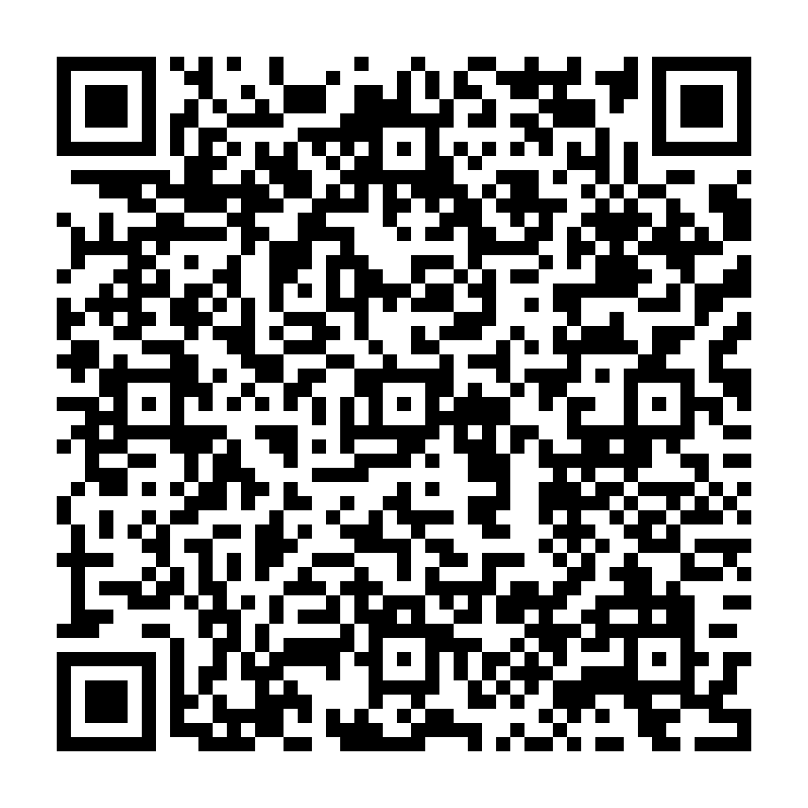

# Android용 FilmOne

[English](README.md) · 한국어

사진 한 장 또는 폴더를 선택하면 사진마다 장면을 인식해 필름을 고르고, 필요한 경우에만 노이즈를 줄인 뒤 새 JPEG 사본으로 저장합니다. 사진은 기기 안에서 처리합니다.

**[공개 다운로드 페이지](https://kangk1204.github.io/FilmOne-Downloads/?lang=ko)** · **[0.5.3 APK 바로 다운로드](https://github.com/kangk1204/FilmOne-Downloads/releases/download/v0.5.3/FilmOne-0.5.3-preview.apk)** · [릴리스 안내](https://github.com/kangk1204/FilmOne-Downloads/releases/tag/v0.5.3)

GitHub 로그인이 필요하지 않습니다. 이 저장소에는 다운로드 파일과 문서만 공개하며 앱 소스는 비공개로 유지합니다.



[QR 코드 저장](https://github.com/kangk1204/FilmOne-Downloads/releases/download/v0.5.3/FilmOne-0.5.3-download-qr.png) · [한국어 페이지](https://kangk1204.github.io/FilmOne-Downloads/?lang=ko) · [English page](https://kangk1204.github.io/FilmOne-Downloads/?lang=en)

## 0.5.3 고해상도 배치 개선

배치에서 불필요한 미리보기 JPEG 생성을 생략하고, AI 추론 전에 원본 비트맵을 해제하며, 전송한 결과 버퍼를 재사용합니다. 색상 계산의 반복 작업도 줄였습니다. 출력 픽셀은 0.5.2와 동일합니다. 모바일 저장 실패 시 임시 파일을 정리하면서 이미 저장한 사진은 보존합니다. 노이즈 제거는 타일 처리가 진행되는 동안 계속 실행하며 엔진 오류는 배치를 일시정지해 복구할 수 있게 합니다. 고해상도 CPU 노이즈 제거는 여전히 사진 한 장당 수분 이상 걸릴 수 있습니다.

108장(12MP 72장·24MP 36장, 성능 시험용 확대 이미지)의 브라우저 배치에서 중단·새로고침·재개, 저장 실패·재시도, 원본 불변과 원본 해상도 결과 108개를 확인했습니다. Windows ARM 브라우저 시험이며 휴대폰 성능이나 화질 평가가 아닙니다. 장면 모델 초기화에는 여전히 큰 메모리가 필요하며 실제 Android/iPhone 성능은 미검증입니다.

## 0.5.2 모델 캐시 수정

웹 모델을 IndexedDB에 저장해 Chromium 비공개 환경에서 재현된 메모리 부족 시 캐시 소실을 해결했습니다. 기존 캐시는 재다운로드 없이 이전하며, 저장 실패 시 이전 사본을 유지합니다. 손상된 모델만 지우도록 수정했습니다. APK에는 수정된 공통 편집기와 오프라인 모델이 포함됩니다. 브라우저 데이터 삭제나 비공개 세션 종료 시에는 저장 데이터가 없어집니다.

## 0.5.1 안정성 수정

동명 파일 복구, 네이티브 폴더 선택 실패, 재처리·취소 경합, 손상된 모델 캐시 복구, ZIP 취소, 장면 인식 엔진 장애 복구와 미리보기 메모리 정리를 수정했습니다. 이전 작업 기록에서 동명 파일을 확실히 구분할 수 없으면 잘못 연결하지 않고 새 작업을 안내합니다.

## 설치와 사용

1. **ARM64 Android 7 이상** 휴대폰에서 약 **591 MB** APK를 내려받아 여세요. Android가 요청하면 브라우저의 앱 설치를 허용합니다.
2. **폴더 자동 보정 → 폴더 선택**으로 들어갑니다. 하위 폴더도 포함합니다.
3. 자동 보정을 시작하고 앱을 열어 두세요. 앱을 벗어나면 일시정지하며 저장된 작업을 불러와 이어갈 수 있습니다.
4. 결과는 선택한 폴더 아래 `FilmOne/<작업 ID>/`에 하위 폴더 구조를 유지해 저장합니다. 원본과 기존 결과를 보존합니다. 결과별 전후 비교와 다른 필름으로 새 결과 저장을 지원합니다.

한 장 편집, 앨범 저장, 즐겨찾기, 개인 색감과 저장 크기 선택도 유지합니다. JPEG·PNG·WebP 및 모바일 HEIC 변환을 지원합니다. 입력은 2,400만 화소·40MB·긴 변 16,384px까지입니다. RAW·동영상·상시 폴더 감시·화면을 끈 상태의 연속 처리는 포함하지 않습니다.

패키지 `app.filmone.editor` · 버전 **0.5.3** · 버전 코드 **8**. 앱 화면은 **한국어**이며 사이트 언어 전환은 안내 문서에 적용됩니다. 오프라인 모델 SigLIP2 FP32·YOLOX-Nano·NAFNet-32·SCUNet을 포함합니다. 작은 장면 모델이 품질 유지 비교 기준에 미달해 FP32 모델을 사용하므로 APK가 커졌습니다.

## 미리보기 검증 범위

이전 FilmOne 미리보기와 같은 테스트 인증서로 서명한 APK이며 스토어 출시 버전이 아닙니다. 브라우저 100장 배치, 원본 보존, 중단·재시작, 저장 결과 검증, ZIP 대체 경로와 네이티브 연결 규약을 검사했습니다. 실제 Android/iPhone 실행과 휴대폰 속도·메모리는 검증하지 못했습니다. 독립 평가에서 장면 인식 품질 목표를 달성했는지도 아직 확인되지 않았으며 결과별 필름을 변경할 수 있습니다.

## 파일 검증

파일 크기 **590,731,454바이트**. [체크섬 다운로드](https://github.com/kangk1204/FilmOne-Downloads/releases/download/v0.5.3/FilmOne-0.5.3-preview.apk.sha256).

```text
83cd6ec6a4f2a54f5a0b3cc03f1d14365dd08a9b342dd4c140ab81d736fddb60  FilmOne-0.5.3-preview.apk
```

[0.4.0 페이지·QR 보관함](https://kangk1204.github.io/FilmOne-Downloads/0.4.0/?lang=ko) · [0.3.0 페이지·QR 보관함](https://kangk1204.github.io/FilmOne-Downloads/0.3.0/?lang=ko)

## 웹 모델 파일

이 저장소는 웹앱에서 쓰는 Apache-2.0 [SigLIP2 장면 모델 조각](models/siglip2-c9e561942b1e1065/)도 제공합니다. 합계 약 372MB이므로 저장소 전체를 복제하면 용량이 커집니다. 사진 인식과 보정은 기기 안에서 실행하며 이 저장소로 사용자 사진을 보내지 않습니다. Android APK에는 모델이 내장되어 있어 별도로 받을 필요가 없습니다.
