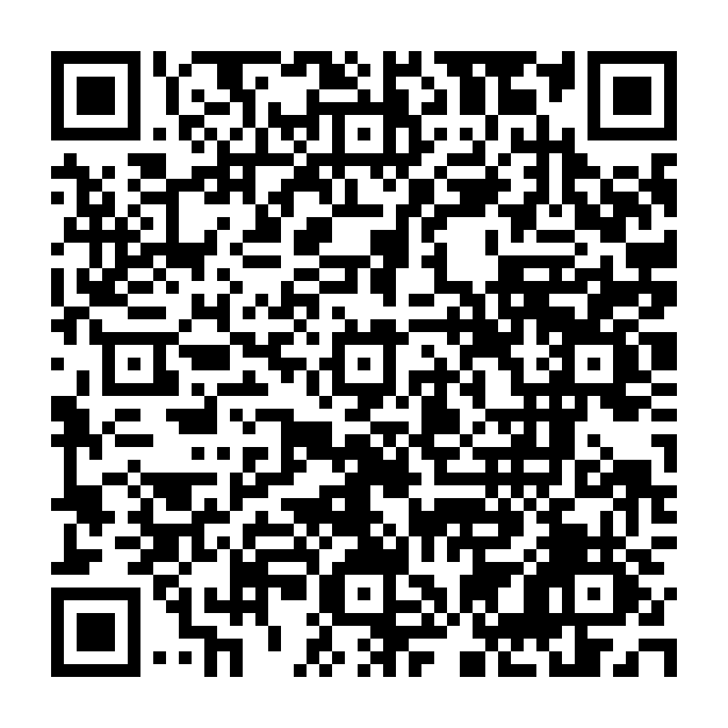

# Android용 FilmOne

[English](README.md) · 한국어

사진 선택 → 자동 필름 보정 → 전후 비교 → 앨범에 새 사본 저장. 사진은 기기 안에서 처리합니다.

**[공개 다운로드 페이지](https://kangk1204.github.io/FilmOne-Downloads/?lang=ko)** · **[0.4.0 APK 바로 다운로드](https://github.com/kangk1204/FilmOne-Downloads/releases/download/v0.4.0/FilmOne-0.4.0-preview.apk)** · [릴리스 안내](https://github.com/kangk1204/FilmOne-Downloads/releases/tag/v0.4.0)

GitHub 회원가입이나 로그인이 필요하지 않습니다. 이 공개 저장소에는 Android 미리보기와 안내 문서만 배포하며 앱 소스는 별도로 관리합니다.

## QR 코드로 다운로드



[QR 코드 PNG 다운로드](https://github.com/kangk1204/FilmOne-Downloads/releases/download/v0.4.0/FilmOne-0.4.0-download-qr.png) · [한국어 페이지 공유](https://kangk1204.github.io/FilmOne-Downloads/?lang=ko) · [English page](https://kangk1204.github.io/FilmOne-Downloads/?lang=en)

QR 코드는 APK에 직접 연결됩니다. 다운로드 페이지에는 English / 한국어 전환과 공유 버튼이 있습니다.

## 설치

1. **ARM64 Android 7 이상** 휴대폰에서 APK를 다운로드하세요. 약 **215 MB**입니다.
2. 파일을 열고 요청이 나타나면 브라우저의 앱 설치를 허용한 뒤 **설치**를 누르세요.
3. FilmOne에서 사진을 고르고 보정 전후를 비교한 뒤 사진 보관함에 저장하세요.

패키지: `app.filmone.editor`, 버전 **0.4.0**, 버전 코드 **4**. 편집기·필름 엔진·NAFNet·SCUNet 자산이 내장되어 오프라인 편집을 지원합니다. APK의 화면 언어는 **한국어**입니다. 다운로드 페이지의 언어 전환은 앱에 적용되지 않습니다.

스토어 배포용이 아닌 테스트 키 서명 미리보기입니다. 0.2.0과 같은 인증서로 서명했습니다. 다른 키로 서명한 앱이 설치되어 있으면 업데이트가 거부될 수 있습니다. 실제 Android 기기의 사진 선택·권한·앨범 저장·처리 속도는 아직 검증하지 못했습니다. 빌드와 브라우저 브리지 검사를 실기기 검증으로 해석하면 안 됩니다.

## 파일 검증

[SHA-256 체크섬 다운로드](https://github.com/kangk1204/FilmOne-Downloads/releases/download/v0.4.0/FilmOne-0.4.0-preview.apk.sha256)

```text
86c5256b23f85ee8792eac48922e741d36a1fe8cf2c9632d555fe773b4794b38  FilmOne-0.4.0-preview.apk
```

파일 크기: 214,758,408바이트. 2026년 11월 8일 비로그인 환경에서 전체 파일을 다운로드해 위 체크섬과 일치함을 확인했습니다.

## 0.4.0 개선

필름 즐겨찾기, 최대 20개 개인 색감 저장·재적용, 필름 종류별 탐색, 조절값 개별 초기화, 원본·2048px·1080px JPEG 저장을 추가했습니다. 사진은 저장하지 않으며 앱/브라우저 데이터 삭제 시 개인 색감도 지워집니다.

[0.3.0 다운로드 페이지와 QR 보관함](https://kangk1204.github.io/FilmOne-Downloads/0.3.0/?lang=ko)
